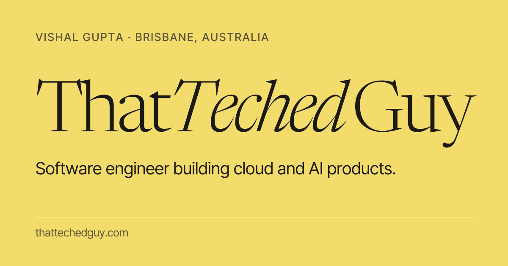

### Hi, I'm ThatTechedGuy 👋

An AI engineer in Brisbane, building cloud and agentic products for one of Australia's oldest banks. 
Off the clock I'm on a tennis court, over a chessboard, or making things about code and games.

## The record

**20+ products shipped since 2020**, across fintech, SaaS, agriculture, retail and telecoms. For banks, startups and the occasional ecologist.

- **Westpac Group** · Gold Coast · _2025 – now_ 
  Consumer retail banking on Westpac UNITE, the bank's multi-billion-dollar technology programme, working on cloud and AI problems.
- **8seats** · Sydney · _2023 – 2025_ 
  A real-time messaging platform. Led the move to Expo and to a distributed Elixir and Phoenix backend; built payments and subscriptions on Stripe.
- **DreamWalk** · Brisbane · _2022 – 2023_ 
  End-to-end product work at an app consultancy.
- **smallcase** · Bengaluru · _2020 – 2021_ 
  A fintech unicorn's React Native app, as it grew from 100,000 to more than 2 million users.
- **The University of Queensland** · Brisbane · _2021 – 2022_ 
  Bachelor of Engineering (Honours) in Software Engineering.

## Selected work

-  **[Yank](https://thattechedguy.com/yank)**: a free, open-source clipboard manager for the Mac, in Swift and SwiftUI. [Code](https://github.com/ThatTechedGuy/Yank) · [Download](https://github.com/ThatTechedGuy/Yank/releases/latest)
-  **[thattechedguy.com](https://thattechedguy.com)**: my site, built with Next.js, React and Bun; its home page scores 100 on every Lighthouse category. [DOCUMENTATION.md](DOCUMENTATION.md) explains how it's built.

## Works in

 

Whatever the problem needs. I pick up tools as I go.
